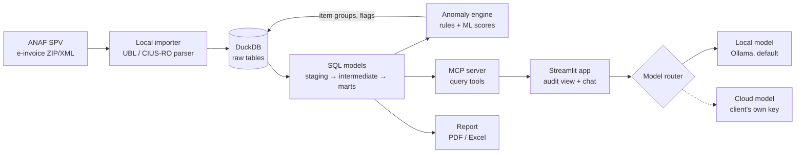

# e-Factura Anomaly Audit

A locally run tool that audits a Romanian company's supplier e-invoices (RO e-Factura, UBL 2.1 / CIUS-RO).
It finds near-duplicate invoices, supplier price increases, unusual amounts, odd VAT patterns and supplier
master-data changes, ranks them with evidence, produces an Excel/PDF report for the controller, and lets the
finance team explore the results through an AI assistant that runs on a local model by default.

Everything runs on the client's machine. The only optional outbound call is to a cloud model the client
enables with their own API key.

> Flags are prompts to check, never conclusions. The tool gives no tax or accounting advice.

**Direction (Oct 2026):** the product is becoming a website where the same engine runs in the user's browser
(Pyodide), with server-side ANAF sync and alerts as a later paid tier. This repo's CLI, Streamlit app and MCP
server stay for internal testing. The web app (same screens and results as the Streamlit app, engine in the
browser) is in [`web/app/`](web/app/); the plan is in [`STATUS.md`](STATUS.md).

Current state and next steps: [`STATUS.md`](STATUS.md). Validation kit: [`docs/validation/`](docs/validation/).

---

## Quick start

**Windows** (Python 3.11+ from python.org):

```powershell
scripts\install_windows.bat          # or: powershell -ExecutionPolicy Bypass -File scripts\install_windows.ps1
.venv\Scripts\efactura-audit -w %USERPROFILE%\efactura-demo demo      # synthetic data, end to end
scripts\start_app.bat -w %USERPROFILE%\efactura-demo                  # opens http://127.0.0.1:8501
```

**macOS / Linux:**

```bash
bash scripts/install.sh
.venv/bin/efactura-audit -w ~/efactura-demo demo
.venv/bin/efactura-audit -w ~/efactura-demo app        # opens http://127.0.0.1:8501
```

`-w/--workspace` goes before the command (`efactura-audit -w <folder> app`). Without it the workspace is
`~/.efactura-audit` (or `EFACTURA_HOME`). Use one workspace per client.

The demo generates 18 months of synthetic invoices for a fictional distributor (≈960 invoices, 22 suppliers,
spanning the 1 Aug 2025 VAT change), injects 32 known anomalies, imports them from ANAF-style ZIPs, runs the
audit and prints how many were found.

## Using it with a client's invoices

1. **Get the invoices.** Download the ZIPs from ANAF SPV (each holds `<id>.xml` + `semnatura_<id>.xml`), or take
   the client's own archive / an export from their accounting software. ANAF keeps SPV messages for about 60
   days, so a 12-month audit needs the client's archive. Folders, nested ZIPs and bare XML all work.
2. **Import:** in the app (Import tab: upload or point to a folder) or
   `efactura-audit import <folder> --buyer-cui RO12345678 --audit`. The buyer filter skips invoices for other
   companies; exact duplicates and non-invoice files (signatures, ANAF error messages) are skipped and logged.
3. **Review flags** (Flags tab): filter, open a flag to see its evidence, the invoices involved and what to
   check, then mark it *confirmed* or *dismissed* with a note. Dismissed flags stay dismissed on re-runs.
4. **Report:** Report tab or `efactura-audit report --lang ro` → Excel (summary, ranked flags, suppliers) and PDF.
5. **Ask the assistant** (AI assistant tab), e.g. "Care furnizori au crescut prețurile cel mai mult?".
6. **Check the data itself** (Data tab): every table and model with its lineage, column docs and a preview;
   charts (spend per supplier and month, a supplier's invoices with flagged ones marked, an item's price history);
   the data tests with their failing rows; and a read-only SQL box with CSV download.

## The five checks

| Check | Rules | Severity logic |
|---|---|---|
| **Near-duplicates** | Same supplier, same total (±0.05 lei by default), line-item similarity ≥ 0.85, and a changed number or date: `same_number_new_date`, `same_date_new_number`, `close_dates` (≤ 14 days), `similar_number` (suffix/transposed digits) | High for same number or same date; lowered to low when the supplier bills that exact pattern routinely, or when a credit note for the same amount exists (cancel-and-reissue) |
| **Price increases** | Per supplier and item: unit price (RON) above the item's 12-month median by > 8 % **and** above its trimmed historical max by > 2 %; consecutive increases fold into one flag (`step`, `creep`, `extreme`). `cross_supplier`: the same product costs ≥ 25 % more than at another supplier | By % increase and extra cost paid vs the old price |
| **Unusual amounts** | Per-supplier robust z-score (median/MAD) on log amount, or ≥ 2× the supplier's 95th percentile; fixed monthly amounts that change; `decimal_shift` (quantity or unit price ~8×+ the item's usual); Isolation Forest + autoencoder over invoice features, reported only when both agree and nothing simpler explains it | Decimal shifts high; model-only signals low |
| **VAT patterns** | `rate_not_valid_for_date` (19/9/5 % until 31 Jul 2025, 21/11 % after — Law 141/2025), `arithmetic` (VAT ≠ base × rate, totals not adding up), `reverse_charge_with_tax` (AE with VAT), `category_rate_mismatch`, `rate_deviation` (item billed in a different VAT class than usual) | Low within 60 days of a rate change and for 9 % (transitional housing rules) |
| **Supplier changes** | `iban_one_off` (a few invoices to another account, then back — the payment-redirection pattern), `iban_changed`, `shared_iban` (different CUIs, same account), `iban_invalid`, `invalid_cui` (control digit), `new_supplier`, `name_changed` | One-off IBAN and shared IBAN high; new supplier high only with another risk signal |

**Item-name matching.** Lines are grouped per supplier by seller item code, or by fuzzy matching of normalised
names ("Hârtie copiator A4 80g/mp, top 500 coli" = "HARTIE A4 80G 500 COLI/TOP"). Matching is strict on purpose:
numbers must agree (315/70 never matches 295/80), and differing words must be spelling variants
(pix/pixuri) or packaging words — "Transport București–Cluj" never merges with "București–Iași", nor "energie
activă" with "reactivă". A wrong merge invents price increases; a missed merge only thins history.

**Thresholds** live in `<workspace>/config.toml` (`efactura-audit init` writes a commented copy). Review
feedback per rule (`efactura-audit status`, Settings tab) shows where to tune.

### Detection quality (synthetic data)

Measured with `efactura_audit.evaluate` against the generator's ground truth. These are synthetic numbers: they
show the checks work as designed, not how they will do on a real client's data.

| Dataset | Recall on injected anomalies | Flags explained by an injected anomaly |
|---|---|---|
| Demo (seed 7, 964 invoices) | 100 % (32/32); legitimate cancel-and-reissue correctly low | 36/37 |
| 10 random seeds (≈950 invoices each) | 99 % average (worst 97 %) | 96 % average |
| 12× volume (9,895 invoices) | 100 % | 37/47 (the rest: repeat purchases with identical totals, transitional VAT, low model signals) |

Speed on 9,895 invoices: import 6 s, full audit 12 s.

## AI assistant

- **Tool-based answers.** The model never sees the database; it calls read-only tools (`audit_overview`,
  `list_flags`, `get_flag`, `search_invoices`, `get_invoice`, `supplier_summary`, `top_suppliers`,
  `price_changes`, `spend_over_time`, `run_sql`) and every figure comes from their SQL results. Each answer shows
  the tool calls and results it used. `run_sql` accepts a single SELECT on a read-only connection with file and
  network access disabled, and is given the marts (`fct_invoices`, `fct_flags`, `dim_suppliers`, …) with their
  documented columns.
- **Model selection.** Ollama (local) is the default. Anthropic, OpenAI and Mistral are off until enabled in
  Settings and use the client's own key (kept in the session only, or read from `ANTHROPIC_API_KEY`,
  `OPENAI_API_KEY`, `MISTRAL_API_KEY`).
- **Only Romanian-tested models are offered.** `efactura-audit test-model --provider ollama --model qwen3:8b`
  (or Settings → Romanian model test) runs 14 tasks in `assistant/ro_taskset.json` on the fixed synthetic
  dataset and scores tool choice, correct figures and names, answer language, valid JSON for structured tasks,
  and refusal of tax advice. A model is approved at ≥ 80 % overall with all structured tasks correct. Results go
  to `~/.efactura-audit/approved_models.json` and count for every workspace on the computer (override the
  location with `EFACTURA_MODELS`). Model IDs in the app are suggestions — confirm current names in each
  provider's docs.
- **What a cloud model receives:** tool results only, after redaction — IBANs masked, 13-digit personal codes
  masked, sole traders' names (PFA/II/IF, personal data under GDPR) replaced by pseudonyms that are mapped back
  locally, and row lists capped at 25. Raw XML never leaves the machine.
- **Data access transport:** direct (in-process, default) or through the MCP server over stdio; answers are
  identical either way.

### MCP server

`efactura-audit -w <workspace> mcp` serves the same read-only tools over stdio to any MCP client. Example for
Claude Desktop (`claude_desktop_config.json`):

```json
{
  "mcpServers": {
    "efactura-audit": {
      "command": "C:\\path\\to\\efactura-audit\\.venv\\Scripts\\efactura-audit.exe",
      "args": ["-w", "C:\\Users\\<you>\\.efactura-audit", "mcp"]
    }
  }
}
```

Note: an external client like Claude Desktop sends tool results to its own cloud model without this app's
redaction, so use it only where the client has agreed to that.

## Architecture



### Data model (dbt-style)

Python writes tables; everything that reads data goes through SQL models in
`src/efactura_audit/transform/`, laid out like a dbt project and built in DuckDB without a dbt
dependency (`{{ ref() }}`, `{{ source() }}`, `schema.yml` tests, so moving to dbt-duckdb later is mechanical).

| Layer | Models | Read by |
|---|---|---|
| **sources** (Python writes) | `raw_invoices`, `raw_invoice_lines`, `raw_vat_breakdown` (importer, append-only); `item_groups`, `flags` (audit engine); `flag_feedback` (reviewers) | staging |
| **staging** | `stg_invoices` (adds `spend_ron`), `stg_invoice_lines`, `stg_vat_breakdown` | intermediate, marts |
| **intermediate** | `int_invoice_lines` (lines + header + price in lei, input to item matching), `int_invoice_features`, `int_vat_subtotals`, `int_invoice_vat_totals`, `int_supplier_ibans` | the checks |
| **marts** | `fct_invoices`, `fct_invoice_lines`, `fct_flags`, `fct_flag_invoices`, `dim_suppliers`, `dim_supplier_bank_accounts`, `mart_supplier_monthly_spend` | checks, app, report, assistant tools, `run_sql` |

- Every model is a view, so imports and audits never need a rebuild step. Views are recreated only
  when the model files change. Column descriptions from `schema.yml` are stored as DuckDB comments,
  and `run_sql`'s table list is generated from the marts' documented columns.
- SQL computes measures (differences, gaps, counts), and Python applies the thresholds from
  `config.toml`. Stateful algorithms (price episodes, duplicate pairing, IBAN sequences, fuzzy item
  matching, Isolation Forest and autoencoder) stay in Python and read the models through `ctx.ref()`.
  Item matching is a Python model: it reads `int_invoice_lines` and writes `item_groups`.
- **Data tests** (35: not_null, unique, accepted_values, relationships, plus checks such as lines not
  adding up to the header, a foreign currency without a RON rate, or several buyers in one workspace)
  run after every import and audit. Results go to `data_test_results` and appear in the Import tab
  and on the CLI. `efactura-audit build -v` rebuilds the models and lists every test.
- `efactura-audit -w <workspace> explore` opens DuckDB's web UI on the workspace, read-only, to browse
  every table and model (Ctrl+C to close; while it's open the app can't save).
- 0.1.x workspaces are migrated in place the first time they are opened: tables are renamed to
  `raw_*`, item groups move out of the lines table, and review feedback is kept.

| Module | Role |
|---|---|
| `importer/parser.py`, `importer/anaf_zip.py` | UBL Invoice/CreditNote parser (credit notes stored negative; EUR converted with the RON VAT total the CIUS-RO profile requires), ANAF ZIP walker |
| `store.py` | DuckDB source tables, bulk import, flags, review feedback, migration of 0.1.x workspaces, short-lived connections so app, CLI and MCP server share one file |
| `transform/` | dbt-style SQL models (`models/staging`, `intermediate`, `marts`), `schema.yml` docs and tests, singular `data_tests/`, and the runner (dependency order, build fingerprint, tests) |
| `itemmatch.py` | Item groups per supplier and across suppliers |
| `checks/` | `duplicates`, `prices`, `outliers`, `vat`, `suppliers` |
| `engine.py` | Runs the checks, consolidates overlapping flags, saves a run |
| `report.py` | Excel (openpyxl) and PDF (reportlab, DejaVu Sans for ș/ț) in RO/EN |
| `assistant/` | `tools.py`, `agent.py` (tool loop), `providers.py` (Ollama, Anthropic, OpenAI, Mistral), `privacy.py`, `backends.py` (in-process / MCP client), `evaluation.py` + `ro_taskset.json` |
| `mcp_server.py` | FastMCP stdio server |
| `app/` | Streamlit UI (Romanian default, English toggle) |
| `synthetic.py`, `ubl_writer.py`, `evaluate.py` | Synthetic ANAF-style data with ground truth, UBL writer, scoring |
| `cli.py` | `demo`, `import`, `audit`, `build`, `explore`, `report`, `app`, `mcp`, `ask`, `test-model`, `feedback`, `status`, `init`, `reset` |

## Legal and data rules, as implemented

| Rule | Where |
|---|---|
| All processing on the client's machine | No server component; the app binds to 127.0.0.1; DuckDB file in the local workspace |
| Cloud models only with the client's key, off by default | `assistant.cloud_enabled = false`; keys from the session or environment, never written to disk |
| Totals and flags to cloud models, not raw invoices | Tools return aggregates; `privacy.Redactor` masks IBANs/CNPs, pseudonymises sole traders, caps rows |
| Read-only: never submits to ANAF | No ANAF write or upload code; only reads downloaded files |
| Flags and descriptions only | Disclaimer on every report and in the app; assistant prompt forbids tax/accounting conclusions and the model test checks it declines |
| Assistant clearly labelled as AI | Label above the chat and on CLI answers |

Screenshots and a sample Romanian report from the demo data are in `docs/`.

## Development

```bash
.venv/bin/python -m pip install -e ".[all,dev]"
.venv/bin/python -m pytest          # 74 tests, ~1 minute (includes MCP subprocess and Streamlit AppTest)
```

`pip install .` installs only the engine (duckdb, pandas, numpy, scikit-learn, lxml, pyyaml), which is also
what runs in the browser. The extras add the rest: `reports` (Excel/PDF), `assistant` (LLM providers, MCP),
`app` (Streamlit, plus both of those), `all`, and `dev` (pytest, plus rapidfuzz for the parity test of
`fuzzy.py`, the pure-Python string similarity that replaced it).

Tests cover the parser (credit notes, EUR, nested ZIPs, non-invoice files), CUI/IBAN validation, item matching,
each check on handcrafted invoices, recall on the synthetic ground truth, feedback persistence, reports, all tool
functions, read-only SQL, redaction, the agent loop, each provider's wire format (mocked HTTP), MCP parity with
the in-process tools, the model test harness, the CLI, an app smoke test, and the model layer (layers only
read upstream, data tests pass on clean data and catch broken data, rebuild only on change, 0.1.x migration).

To change a model, edit the `.sql`/`.yml` under `src/efactura_audit/transform/models/`, then run
`efactura-audit -w <workspace> build -v`. The views are rebuilt and the data tests run.

## Web app (`web/app/`)

The website version: a static site (Vite, React, TypeScript) whose audit engine is this Python package running
in the user's browser (Pyodide in a Web Worker). Invoices are processed and stored in the browser's private
storage (OPFS); nothing is uploaded. Same screens and results as the Streamlit app; the parity checklist is
[`docs/web-parity-checklist.md`](docs/web-parity-checklist.md).

```bash
cd web/app
npm install
npm run dev              # http://127.0.0.1:5180  (landing page; the app is at #/overview)
npm test                 # Playwright in Edge: engine, all screens, landing, storage, performance budget
npm run test:browsers    # engine and landing in Chrome, Firefox and WebKit
npm run build            # static site in web/app/dist
```

`npm run dev` and `npm run build` first run `scripts/prepare.py` (with the repo's `.venv`): it builds the engine
wheel into `public/py/`, exports the UI strings from `app/i18n.py` (one RO/EN source for both apps), and
writes the native engine's demo results that the browser tests compare against. The browser calls the engine
through `efactura_audit/web.py` (one JSON method per screen, the same queries as the Streamlit app).

## Known limits and next steps

- **Validate on real invoices.** Everything here is tested on synthetic data. The first pilot should run on a
  real 12-month archive with the controller reviewing flags; the feedback table is the input for tuning.
- **Reasoning models:** `<think>…</think>` blocks (Qwen3, DeepSeek-R1) are stripped from answers before they
  are shown or scored.
- **Run the Romanian model test on real models.** The harness is tested with scripted models; no local or cloud
  model has been approved yet. Candidates to try first: `qwen3:8b`, `llama3.1:8b`, `mistral-nemo` via Ollama.
- **Strict item matching can split one product.** "Toner compatibil HP 85A" and "Cartuș toner compatibil 85A
  negru" stay separate items (the differing words could mean a different product), so one price increase can
  show as two flags. Seller item codes, when suppliers send them, avoid this; a per-client synonym list in
  `utils._SYNONYMS` is the quick fix.
- **Repeat purchases with identical totals** (same quantity, same fixed price, days apart) remain the main
  source of medium-severity duplicate flags; the controller dismisses them once and they stay dismissed.
- **Website:** the web app (`web/app/`) has every screen of the Streamlit app. Still to build: login and
  company profile, hosting, and later server-side ANAF OAuth sync with alerts. See the plan in `STATUS.md`.
- Out of scope for now: cash-flow forecasting and other countries' formats.
